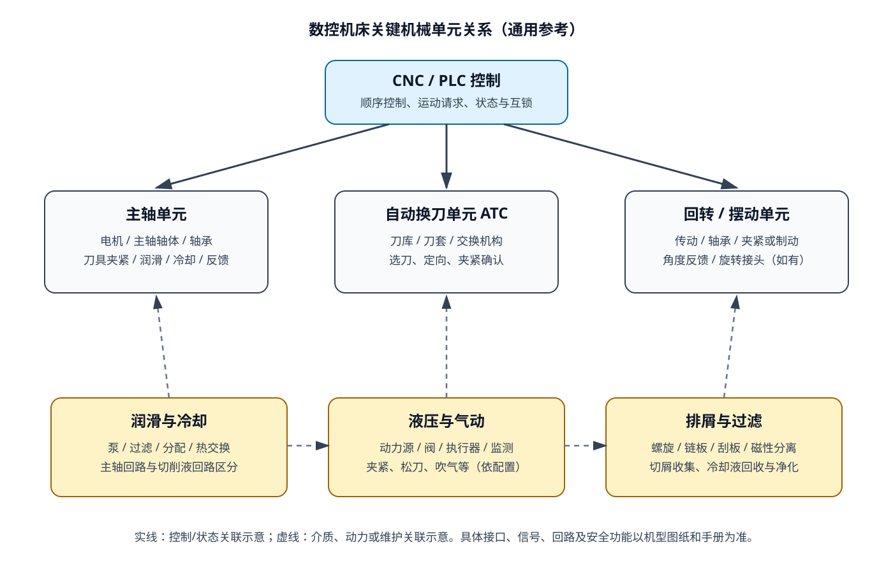

# 数控机床关键机械单元：主轴、换刀、转台与辅助系统

> **知识条目：** KNOW-000014  
> **章节：** CH03 — 整机架构与机械结构  
> **版本：** 1.0  
> **核验日期：** 2026-11-22  
> **适用范围：** 典型数控切削机床的主轴单元、自动换刀单元、数控回转工作台，以及润滑、冷却、液压/气动和排屑等辅助机械单元。本文是结构与系统工程参考，不是具体机型BOM、参数设定表、维修作业指导或安全回路图。

## 1. 任务边界与单元视图

本专题承接[整机功能架构](./architecture.md)和[主要机械结构、导向与进给传动](./major-mechanical-structures.md)。前者说明系统分层，后者已覆盖床身/基础件、运动部件、导向副、滚珠丝杠、齿轮齿条、联轴器和丝杠支承。本专题进一步分析四类关键单元：

1. **主轴单元**：把主运动驱动、轴承支承、刀具/工件接口、夹紧机构、润滑、冷却和状态监测集成为旋转执行单元。
2. **自动换刀单元（ATC）**：在刀库、选刀/预选、刀具交换机构、主轴定向与刀具夹紧状态之间完成受控交接。
3. **数控回转工作台/摆动单元**：承载工件或夹具，提供分度、连续回转或摆动轴运动，并处理夹紧、制动、反馈和介质通道。
4. **辅助介质与排屑单元**：向关键摩擦副、主轴和切削区提供润滑/冷却/动力介质，并处理切屑、过滤、回液和污染物。

这些单元并非每台机床都具备。车床的工件主轴、加工中心的刀具主轴、车铣复合机床的主/副主轴和铣削主轴在功能、接口和工况上均可能不同；ATC通常属于具备自动换刀功能的加工中心或复合机床；转台可能是机床内置轴、外加附件或托盘定位机构。必须先确认机型、选项和配置，再讨论其结构与控制接口。

## 2. 主轴单元（Spindle Unit）

### 2.1 功能组成与能量路径

主轴单元的核心任务是在规定工况下支承并驱动刀具或工件旋转，维持旋转轴线、承受切削载荷，并提供与刀具/卡盘、冷却、润滑、夹紧及反馈系统的接口。典型功能模块包括：

- 主轴轴体/主轴芯轴及刀具接口或卡盘接口；
- 前后轴承组、隔套、锁紧/预紧结构和主轴壳体；
- 驱动电机（内装式电主轴或外置电机经皮带/齿轮传动）；
- 刀具拉紧机构、松刀机构、拉刀杆、碟形弹簧组或液压/气动执行机构（按设计配置）；
- 轴承润滑、主轴/电机冷却、气幕/正压防护、刀具内冷通道（如配置）；
- 角度/速度反馈、温度、振动或夹紧状态检测（依具体配置）。

主运动能量路径可抽象为“电源/驱动器 → 电机 → 主轴转子/传动机构 → 主轴轴体 → 刀具或工件”。切削力经刀具/工件接口、主轴轴承、主轴壳体和机床结构闭合；热量则由轴承摩擦、电机损耗、传动损耗及切削热等路径产生，需由润滑、冷却、结构导热和控制策略共同管理。

### 2.2 典型驱动与结构形式

| 方案 | 结构特点 | 主要优势/限制 | 典型关注点 |
|---|---|---|---|
| 内装式电主轴 | 电机转子与主轴轴体集成，定子布置在壳体内 | 传动链短、适合高速集成；电机热与轴承热集中，冷却和维修要求高 | 电机/轴承冷却回路、热伸长、动平衡、轴承转速和润滑 |
| 外置电机+皮带 | 电机经皮带/带轮驱动主轴 | 结构相对易维护，可通过带轮比匹配转速/转矩；皮带弹性、张紧和磨损影响传动 | 带轮对中、张紧、振动、传动效率和防护 |
| 外置电机+齿轮箱 | 通过齿轮传动获得转速/转矩范围 | 可适应较宽转矩工况；齿轮啮合噪声、润滑和换挡机构增加复杂度 | 齿轮润滑、啮合状态、换挡/联锁、温升 |
| 工件主轴/车床主轴 | 通过卡盘、夹头或专用接口夹持工件 | 需要同时满足夹持力、转速、工件惯量和切削力 | 卡盘/夹头接口、拉管、夹紧确认、动平衡和工件甩出风险 |

### 2.3 轴承布置、润滑与热管理

主轴轴承可能采用角接触球轴承、圆柱滚子轴承、混合陶瓷轴承或其他适合目标工况的结构组合。前后轴承的配置、接触角、跨距、预紧方式和润滑方式共同影响径向/轴向刚度、允许转速、温升、寿命和振动。不能只凭“陶瓷轴承”“高速轴承”或轴承系列名称推断整根主轴的性能。

常见润滑形式包括脂润滑、油气润滑、油雾或油循环等，具体采用方式取决于轴承、转速、热负荷、密封和维护策略。主轴冷却可能针对电机定子、轴承座或主轴壳体设置独立/组合回路。Siemens 2SP1主轴单元说明了电机定子液冷回路及外部泵/热交换系统的责任边界，也明确冷却介质温度需避免低于环境温度导致冷凝；这些是该系列设备的操作要求，不能直接作为所有主轴的设定值。[SRC-000084]

热管理设计至少需要区分：电机损耗、轴承摩擦热、传动热、冷却液入口温度/流量、壳体温度梯度、环境温度和暖机状态。热平衡并非简单地“冷却越强越好”：温度过低可能导致冷凝，入口温度波动可能引起尺寸漂移，流量不足或过滤堵塞可能导致热失控。具体温度、流量、压力、油品和报警阈值必须查阅主轴与冷却单元对应型号的手册。

### 2.4 刀具接口与夹紧安全

加工中心主轴常见刀具接口包括BT、CAT、HSK及其他标准/厂商体系；不同接口在锥面/端面接触、拉紧机构、转速适用性、动平衡和自动换刀配合方面存在差异。接口标准和具体主轴型号必须同时核验，不能把相同锥度标记当作完全可互换。

刀具夹紧链包括拉刀杆/夹紧组件、弹簧或执行机构、松刀机构、刀具拉钉/夹持部位及状态检测。应关注夹紧力随磨损的变化、刀具接口清洁、拉紧组件疲劳、松刀压力/行程和刀具到位确认。Siemens 2SP1资料对其主轴单元规定了特定的刀具夹紧与旋转限制，并提示刀具质量、悬伸和转速会影响转子系统共振与轴承载荷；该限制仅适用于该产品文件，不得抄作通用转速规则。[SRC-000084]

**安全边界：** 高速旋转刀具具有极高动能。不得在防护门打开、刀具未可靠夹紧、接口污染或刀具/刀柄超出允许转速时运行。任何松刀、拉紧机构拆装、主轴吊装和高速试运转都必须按具体主轴与机床制造商程序执行；维修前隔离电能、气压/液压和可能的重力/弹簧储能。

## 3. 自动换刀单元（Automatic Tool Changer, ATC）

### 3.1 组成与基本动作链

ATC并非单一“刀库”，而是由刀具储存、选刀定位、刀具交换、主轴夹紧/松开、刀具识别和顺序控制构成的协同单元。典型组成：

- 刀库（刀盘/伞式、链式、鼓式、矩阵式或其他布局）及刀套/刀位；
- 刀库驱动、分度机构、制动/定位和刀位检测；
- 交换机构（双臂机械手、单臂、摆臂、直线移载或其他结构）；
- 主轴定向、松刀/夹刀执行机构和刀具存在/夹紧检测；
- 刀具数据表、刀位映射、预选逻辑和机床PLC顺序控制；
- 防护门、区域隔离、异常恢复和手动维护接口。

抽象换刀流程为：确认主轴停转并定向 → 选择/预选目标刀位 → 刀库移动到交接位置 → 交换机构取出当前刀具并取得目标刀具 → 主轴松刀/交接/夹紧 → 确认刀具存在和夹紧状态 → 交换机构退回、刀库复位 → 更新刀具与刀位状态。具体动作先后、是否双臂同步、刀具是否先移至缓存位、主轴定向方式和互锁条件均依机型设计及PLC程序定义。

Haas的伞式换刀维修资料把单元分为刀库组件与穿梭/移载组件，侧挂式换刀器则有转盘、刀套、驱动和独立交换机构等结构；该资料可用于说明其具体系列的结构实例，不代表所有OEM的ATC拓扑。[SRC-000085]

### 3.2 常见刀库和交换布局比较

| 类型 | 典型结构 | 优点 | 局限/工程关注点 |
|---|---|---|---|
| 伞式/盘式刀库 | 刀位沿圆盘周向布置，刀库整体或局部移至主轴附近 | 结构相对紧凑，适合较小容量与紧凑机型 | 刀库移动/穿梭空间、刀具相邻干涉、刀具质量和长度限制 |
| 侧挂链式刀库 | 刀套沿闭环链条布置，刀库固定在主轴侧面，配合交换臂 | 容量可扩展，适合中大型加工中心 | 链条/刀套磨损、链传动张紧、刀具重量分布、交换臂空间 |
| 鼓式/转塔式刀库 | 刀位沿鼓体周向排列，按角度分度 | 布局紧凑，换刀路径可较短 | 刀位容量、转动惯量、重心和刀具干涉限制 |
| 矩阵/仓储式刀库 | 刀具按二维或多层刀位存放，经搬运机构转运 | 可实现较大容量和复杂刀具管理 | 机械/控制复杂度、缓存与路径规划、恢复策略和占地 |

刀库容量不是单独的性能指标。还要考虑最大刀具直径/长度/质量、相邻刀位是否允许空位、刀具重心和惯量、刀套形式、换刀时间定义（刀到刀/切削到切削）、预选方式、刀具编码、刀具破损检测和异常恢复能力。学术研究中的具体刀库容量与换刀时间属于对应设计案例，不应作为行业通用基准。[SRC-000090]

### 3.3 控制接口与异常状态

ATC通常由CNC发出换刀请求，由PLC或机床逻辑控制器协调主轴定向、刀库分度、气液压动作、位置开关和夹紧检测。控制接口至少应定义：请求/完成握手、当前刀号/目标刀号、刀位映射、刀库就绪、主轴定向完成、松刀/夹刀状态、机械手原位/交换位、刀具存在、门/护罩状态、超时和故障复位条件。

状态信号不能只依赖单一“换刀完成”位。至少需要核对目标刀位、机械手位置、主轴夹紧状态和刀具存在状态是否形成一致闭环。传感器短路/断线、刀具重量或长度超限、刀位数据与实际刀位不一致、机械手未回原位、气压不足、主轴未定向等情况均可能导致换刀中止。具体报警号和恢复顺序依CNC/PLC版本和机床OEM定义，应在CH07/CH18按型号另行建档。

## 4. 数控回转工作台与摆动单元

### 4.1 功能模式

回转单元可承担三类不同任务：

- **分度定位：** 旋转到指定角度后机械夹紧，切削时主要由夹紧机构承担抗切削转矩与刚度要求。
- **连续回转：** 切削过程中回转轴持续参与轨迹插补，需重点考虑传动误差、角度反馈、速度波动和动态刚度。
- **摆动/倾斜：** 回转轴与倾斜轴组合成摇篮或摆头结构，工作空间、重心变化、倾覆力矩和轴间几何关系更复杂。

回转台可能位于工件侧（转台/摇篮），也可能位于刀具侧（摆头/回转主轴）。同样的A/B/C轴字母不能替代对实际轴线方向、安装位置和运动部件的确认。

### 4.2 典型传动和夹紧方案

| 方案 | 传动/结构 | 主要特征 | 选型关注点 |
|---|---|---|---|
| 蜗轮蜗杆 | 伺服电机经减速机构驱动蜗杆/蜗轮 | 可获得较大减速比和输出转矩；啮合摩擦、磨损和反向间隙需管理 | 传动效率、热、润滑、回差、夹紧与切削承载 |
| 滚子凸轮/滚子齿轮 | 凸轮曲面与滚子啮合传动 | 可针对分度速度、刚度和间隙设计；依赖具体几何与预载 | 允许连续/分度工况、承载、接触应力、润滑和寿命 |
| 直驱力矩电机 | 力矩电机直接驱动转台 | 无机械减速级的传动回差，适合连续回转与高动态；需要高转矩电机、冷却和高分辨率反馈 | 峰值/连续转矩、热、制动/失电保持、反馈精度和成本 |
| 机械齿式定位/端齿盘 | 通过端齿盘或Hirth联接等结构实现重复机械定位 | 夹紧后可形成高刚度的机械定位界面 | 分度角、接触清洁、夹紧力、齿面磨损和重复定位 |

Kitagawa的NC回转台目录展示了蜗轮蜗杆、滚子齿轮/凸轮等不同传动产品，并分别列出夹紧方式、减速比、允许惯量、定位精度和重复定位精度；其数据只能用于相应型号和规定工况。部分型号还明确区分M信号规格与第四轴控制规格，说明“能旋转”不等于已具备特定CNC回转轴接口。[SRC-000086]

### 4.3 关键参数与误差来源

选型和集成至少核对：

- 台面直径、中心孔/通孔、中心高、安装方向和接口尺寸；
- 允许工件质量、夹具质量、重心偏置、允许惯量和倾覆力矩；
- 连续/峰值驱动转矩、夹紧转矩、允许切削转矩和制动能力；
- 最大转速、角加速度、分度时间和工作制；
- 角度反馈位置、编码器分辨率、定位精度、重复定位精度和反向误差；
- 液压/气动压力、夹紧/松开确认、旋转接头通道数及其介质限制。

定位精度与重复定位精度不是同一指标；夹紧转矩、驱动转矩和允许切削转矩也不能互换。外部负载的质量相同，因重心偏置和转动惯量不同，轴承载荷和动态响应也可能显著不同。对五轴联动应用，还必须考虑旋转中心标定、轴线位置误差、热漂移和机床运动学参数；这些测试与补偿方法由CH14/CH12继续展开。

## 5. 润滑、冷却、液压与气动辅助系统

### 5.1 集中润滑

集中润滑系统通过泵、油箱、过滤器、分配器/计量元件、管路和监测装置向导轨、丝杠、轴承或其他润滑点供给规定介质。典型架构有单线电阻式、递进式、双线式和油气系统等；并非所有系统都能用相同油品、压力、周期或计量元件。

设计/维护需建立润滑点清单，至少记录润滑点位置、介质类型/黏度等级、单次供给量、供给周期、分配器规格、泵运行反馈、低液位/压力监测和管路可达性。Bijur Delimon的技术说明强调应逐点识别润滑位置、类型和所需油量，并按系统结构选用相应计量/分配元件；具体供油量和周期仍应由机床OEM及润滑元件型号确定。[SRC-000087]

常见异常包括油箱缺液、油品混用、过滤堵塞、泵失效、分配器堵塞、管路泄漏/折弯、传感器误报和润滑点污染。发现润滑报警时不能简单屏蔽报警继续加工；应依据设备手册判断是否需要停止运动并检查润滑供给是否真实到达目标点。

### 5.2 切削冷却与主轴冷却

切削液系统通常由储液箱、泵、过滤、阀/管路、喷嘴或主轴中心出液通道组成；可采用外部浇注、主轴中心出液、刀具内冷或高压冷却等配置。其目标可能包括切削区冷却、润滑、排屑、刀具寿命和工件表面质量，但各目标间存在介质、压力、流量和过滤等级的匹配约束。

主轴冷却与切削冷却不能混为一谈：主轴冷却回路负责控制主轴电机/轴承热状态，切削液回路负责工艺区域介质供应。两者可能共用热交换/冷却基础设施，但介质回路、洁净度、压力和控制责任应按机床设计区分。Haas服务手册将辅助过滤、单级/多级浇注冷却、主轴中心出液、冷却机、冷却液液位、过滤排屑和油雾处理列为不同功能模块，体现了冷却与排屑系统的配置差异。[SRC-000089]

### 5.3 液压与气动

液压系统常用于卡盘/夹具夹紧、转台夹紧、主轴松刀、刀库动作、平衡缸和其他需要较大力或刚性执行的机构；气动系统常用于吹气、气幕、轻载执行、刀具接口清洁和某些夹紧/换刀动作。实际应用可能使用液压、气动、增压气液或电动执行器组合。

系统模块可能包括动力源、储能器、泵/压缩空气接口、过滤、调压/减压、溢流、方向阀、节流阀、压力/位置传感器、管路、执行缸和回油/排气。压力等级、蓄能器容量、介质兼容性和失压状态属于具体设计参数，必须以原厂液压/气动图和元件铭牌核验。维修前须泄压并确认蓄能器、弹簧、垂直轴平衡等储能已安全释放；不得在带压状态拆卸管路或阀件。

## 6. 排屑、过滤与污染控制

排屑系统将切屑从加工区输送到收集/处理位置，常见形式包括螺旋排屑器、刮板/链板式、铰接钢带式、磁性排屑器、提升式和组合过滤排屑系统。选型与切屑形态密切相关：长卷屑、短碎屑、粉末/细屑、铸铁屑和铝屑的缠绕、沉降、磁性和磨蚀特性不同。

冷却液过滤系统可采用滤网、纸带、滚筒、磁性分离、沉降、离心或多级组合。过滤精度必须结合泵、喷嘴/刀具内冷通道、切削材料、冷却液类型、流量和维护策略定义；供应商标注的“名义微米数”不应误读为绝对过滤效率或整机冷却液清洁度保证。Mayfran ConSep系列公开资料展示了钢带输送、刮板细屑分离和自清洁滚筒过滤组合，以及针对特定型号声明的名义过滤等级；这些数值仅适用于对应产品配置和厂商测试口径。[SRC-000088]

污染控制还应覆盖切屑从机床排出后的落料、容器更换、冷却液回流、浮油/油雾处理、过滤器压差、液位、温度和泄漏监测。排屑器堵转、反转、过载和开门停机逻辑属于机床OEM控制策略，不能跨型号照搬参数。Haas公开操作资料中的螺旋排屑器反转/过载逻辑仅为对应机型的实现示例，不是所有排屑器的统一动作规则。[SRC-000089]

## 7. 关键单元选型与验证矩阵

| 单元 | 需求输入 | 关键设计/选型参数 | 系统接口 | 验证关注点 |
|---|---|---|---|---|
| 主轴 | 工艺、刀具/工件、转速/转矩范围、切削力、精度与工作制 | 轴承组合、支承跨距、驱动形式、刀具接口、夹紧、润滑冷却、反馈 | 电源/驱动、冷却、润滑、气液压、刀具、CNC/PLC | 转速/转矩、温升、振动、跳动、夹紧状态、热稳定 |
| ATC | 刀具数量/尺寸/质量、换刀节拍、自动化等级 | 刀库形式、刀位数、机械手结构、驱动/制动、缓存、传感器 | CNC/PLC、主轴定向/松刀、气液压、门锁与安全区 | 刀位一致性、换刀循环、夹紧确认、干涉、异常恢复 |
| 回转台 | 轴数、工作空间、工件质量/重心、分度或连续加工 | 传动、反馈、夹紧/制动、允许惯量/力矩、中心孔与接口 | CNC轴、伺服驱动、编码器、液压/气动、夹具/旋转接头 | 定位/重复性、回转误差、夹紧刚度、热漂移、同步 |
| 润滑 | 润滑点数量/类型、介质、环境与工作制 | 泵、分配器、计量量、周期、过滤、监测 | 电源/PLC、油箱、管路、导轨/丝杠/轴承 | 末端供油、报警有效性、泄漏、油品与污染 |
| 冷却/过滤 | 工艺热负荷、介质、流量、喷射位置、过滤需求 | 泵、流量/压力、温控、过滤等级、换热能力 | 主轴/切削回路、刀具、过滤器、排液 | 温度稳定、流量/压力、洁净度、泄漏、冷凝风险 |
| 液压/气动 | 执行力、速度、动作频率、失压状态 | 压力、流量、缸径、阀、储能、过滤和监测 | 夹紧、松刀、转台、刀库、PLC | 夹紧力/位置、压力保持、泄漏、失压安全状态 |
| 排屑 | 切屑材料、形态、长度、产屑量、机床布局 | 输送形式、容量、坡度、过滤、排放高度、堵转检测 | 加工区、冷却液箱、泵、收集容器、PLC | 连续排屑、堵转/过载、回液、切屑缠绕和清理可达性 |

验证应分层进行：部件级检查（接口、铭牌、装配、介质）；单元级空载/负载功能测试；整机联锁与顺序测试；加工工况下热、振动、精度和切屑处理验证。任何测试数值都必须记录机型/配置、测点、环境、暖机、载荷、测量设备、方法和软件版本。没有具体设备和测试记录时，本专题不提供通用验收阈值。

## 8. 维护、失效征兆与安全边界

| 单元 | 关注的异常征兆 | 需要核查的方向（非故障定论） |
|---|---|---|
| 主轴 | 温升异常、振动/噪声增大、跳动变化、夹紧状态异常 | 冷却流量/温度、润滑、轴承、刀具接口、动平衡、驱动和反馈 |
| ATC | 刀库定位失败、机械手卡滞、刀具掉落/未夹紧、换刀超时 | 刀位映射、传感器、机械干涉、驱动/皮带/链条、气液压、主轴定向 |
| 回转台 | 定位偏差、反向误差、夹紧不足、回转温升 | 反馈基准、传动磨损、夹紧压力、轴承、润滑、偏载与热状态 |
| 润滑 | 低液位/压力报警、局部干摩擦、导轨温升/磨损 | 泵、分配器、过滤、管路、油品、末端供油和报警检测 |
| 冷却/过滤 | 冷却不足、过滤压差上升、泵噪声、冷却液溢流 | 液位、过滤堵塞、泵、喷嘴、回液、换热器和污染物 |
| 液压/气动 | 动作变慢、夹紧/松开失败、压力波动、泄漏 | 供压、过滤、阀、密封、执行缸、储能器及压力检测 |
| 排屑 | 输送停滞、堵转、切屑堆积、回液异常 | 切屑形态、缠绕、刮板/链板/螺旋、驱动过载、液位与过滤 |

表中是需要调查的方向，不是根因结论。主轴、刀库、转台和液压/气动系统可能存在旋转、夹挤、重力、压力、弹簧和储能危险。执行维修前必须依具体机床手册停机、隔离电源、泄压、锁定挂牌并确认所有储能释放；需要吊装或拆卸重件时采用额定吊具并由合格人员操作。不得绕过门锁、急停、刀具夹紧确认、轴限位或其他安全联锁；不得在带电、带压或运动状态下拆装。

## 9. 与其他章节的边界

- [整机功能架构与子系统接口](./architecture.md)：系统分层、子系统和接口关系。
- [主要机械结构、导向与进给传动](./major-mechanical-structures.md)：承载结构、导向副、丝杠/齿轮齿条、联轴器与轴承支承。
- [机床分类与产品](../02-machine-types-and-products/README.md)：机型分类和具体机床配置差异。
- [刀具、工装与工件装夹](../05-tooling-fixtures-and-workholding/README.md)：刀柄、刀具、卡盘、夹具及刀具管理的专题主归属。
- [伺服、主轴与运动控制](../08-servo-spindle-and-motion-control/README.md)：主轴电机、驱动器、编码器、控制环和运动性能。
- [制造、装配、安装与调试](../16-manufacturing-assembly-installation/README.md)：装配基准、主轴/转台安装与调试工艺。
- [操作、维护与维修](../17-operation-maintenance-and-repair/README.md)：设备级点检、润滑、保养与维修作业指导。
- [故障诊断与可靠性](../18-fault-diagnosis-and-reliability/README.md)：故障模式、报警码、根因分析和案例。
- [关键部件供应商与产品目录](../19-manufacturers-products-and-supply-chain/key-component-suppliers-and-products.md)：供应商和产品族主数据；本专题不重复建产品实体，也不推断OEM实际采用。

## 10. 来源与证据边界

- [SRC-000084] Siemens 2SP1 Spindle Units Operating Instructions：该系列主轴的冷却、刀具夹紧和安全说明。
- [SRC-000085] Haas Mill Tool Changer Service Manual：伞式/侧挂式刀库和交换机构的特定系列结构与维护信息。
- [SRC-000086] Kitagawa NC Rotary Table product catalog：TP、RK等回转台系列的结构和型号级参数。
- [SRC-000087] Bijur Delimon Automatic Lubrication Systems FAQ / SLR technical guide：集中润滑系统类型及润滑点设计原则。
- [SRC-000088] Mayfran ConSep 2000 / ConSep Pro product information：排屑与冷却液过滤的组合方案和型号级声明。
- [SRC-000089] Haas Chip and Coolant Service Manual：冷却、过滤、主轴中心出液、排屑和相关辅助模块的具体机型服务信息。
- [SRC-000090] Gökler, “Design of an automatic tool changer with disc magazine for a CNC horizontal machining center,” 1997：盘式刀库/自动换刀的具体设计研究案例。

原厂资料只证明对应产品系列或机型文件所描述的配置和声明；不证明所有OEM采用该结构，也不构成独立性能测试、互换性、通用参数或当前供应能力的证据。学术论文中的设计参数仅属于其研究对象。本文不复制标准全文、厂商图纸或受版权保护的手册。

## 11. 待进一步研究

1. 按具体整机型号建立主轴、ATC、转台和辅助系统的配置级BOM及接口清单（需型号手册/图纸证据）。
2. 将主轴温升、振动、动平衡、轴承寿命和热误差测试方法链接至CH14。
3. 将刀具接口、刀具管理、刀具寿命与工件夹持细节交由CH05深化。
4. 将主轴驱动、电机、编码器、伺服控制和回转轴控制交由CH08/CH12深化。
5. 将润滑、冷却、液压、气动和排屑的点检/保养/故障案例交由CH17/CH18深化。

本文未对任何具体机床执行实机验证；所有未指定型号的参数、压力、温度、流量、夹紧力、刀库容量和换刀时间均不作通用化推断。
