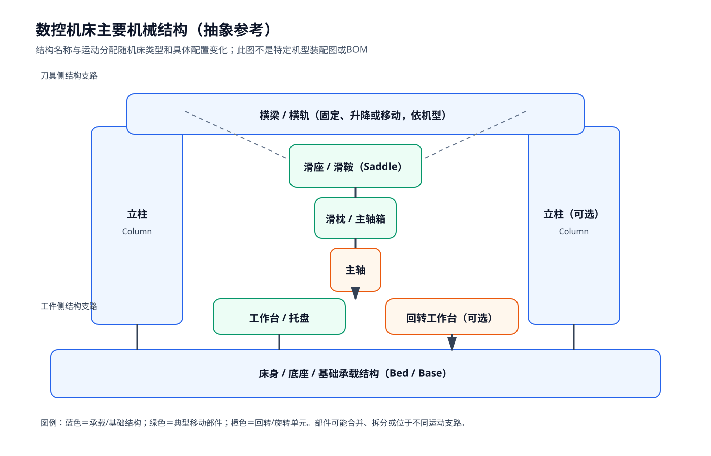
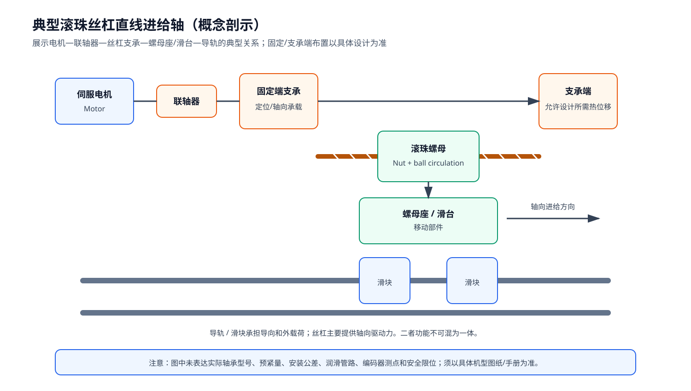

# 数控机床主要机械结构、导向与进给传动

> **知识条目：** KNOW-000013  
> **章节：** CH03 — 整机架构与机械结构  
> **版本：** 1.0  
> **核验日期：** 2026-11-22  
> **适用范围：** 典型数控切削机床的床身/基础件、承载结构、直线与回转运动部件、导向、进给传动、联接和支承。本文是结构原理与参数定义参考，不是任何具体机床的装配图、BOM、验收规范或维修作业指导。

## 1. 范围与阅读方式

机床机械结构承担四类相互耦合的任务：建立刀具与工件之间的相对运动；承受切削力、惯性力和重力并形成闭合力流；维持几何关系和运动精度；把电机/驱动输出的运动传递到执行部件。结构方案必须结合机床类型、行程、工件质量、切削载荷、动态性能、热环境、精度目标和维护条件综合判断。

本文区分三个层次：

1. **结构件/承载件：** 床身、底座、立柱、横梁、滑枕、滑鞍、工作台及其连接结构。
2. **运动与导向件：** 直线导轨/滑动导轨、回转支承、转台、导向副及其安装基准。
3. **进给与联接件：** 滚珠丝杠、齿轮齿条、联轴器、支承轴承、螺母座和电机座等。

不同机型可能把运动分配给刀具侧或工件侧，也可能采用固定立柱/移动立柱、固定横梁/移动横梁、移动工作台/固定工作台等布局。部件名称相同不代表安装位置、运动方向、载荷或接口相同。ISO 8636-1:2026针对固定双立柱、移动工作台的固定横梁（龙门式）铣床给出专门的术语和精度检验范围，不能外推为所有龙门、单柱或移动横梁机床的通用结构定义。[SRC-000077]

## 2. 整机承载结构与运动部件

本专题涉及的跨章节术语由CH01统一维护：床身/底座（TERM-000041）、立柱（TERM-000042）、横梁/横轨（TERM-000043）、滑鞍/滑座（TERM-000044）、滚动直线导轨（TERM-000045）、滚珠丝杠（TERM-000046）、丝杠导程（TERM-000047）、预压/预紧（TERM-000048）和回转工作台（TERM-000049）。完整定义见[全库术语表](../GLOSSARY.md)。

### 2.1 床身与底座（Bed / Base）

床身/底座是机床的主要基础承载结构，为导轨、立柱、主轴箱、工作台、丝杠支承和辅助装置提供安装基准，并把加工载荷、部件自重和运动惯性传递至基础或其他结构件。卧式车床常见床身导轨承载刀架/尾座等部件；立式加工中心可由底座、立柱和工作台构成主要承载闭环；大型龙门机床可能由左右床身/立柱、横梁和基础构成门式框架。

常见构造材料和工艺路线包括铸铁铸件、焊接钢结构、矿物铸件/聚合物混凝土等。材料或工艺本身不能直接决定整机性能：应结合截面与筋板布局、质量分布、连接面、阻尼、刚度、热膨胀、残余应力、加工和时效处理、运输吊装及基础条件评价。铸造结构便于形成复杂筋板和整体形状，但受铸造工艺、壁厚和时效影响；焊接结构便于大型结构制造和设计迭代，但需控制焊接变形、残余应力和后续稳定化工艺；矿物铸件可提供不同的阻尼/热特性，但连接嵌件、长期蠕变、承载和环境适应性必须按具体设计核验。这里不对材料路线作无条件优劣排序。

### 2.2 立柱、横梁与门式结构（Column / Crossbeam）

- **立柱：** 支承主轴箱、滑枕或横梁，并将切削力传递到床身/底座。其高度、截面、导轨间距、连接面和热源布局会影响弯曲/扭转变形与几何稳定性。
- **横梁/横轨：** 在龙门或桥式结构中连接两侧立柱，承载滑座/滑枕等部件。横梁可固定、升降或采用其他可调结构；横梁截面、跨度、支承方式、双侧驱动/同步方式和热梯度均需结合实际机型分析。
- **门式/桥式框架：** 形成跨越工作区的结构闭环。固定横梁、移动横梁、移动工作台和移动立柱方案的质量、行程、工作空间、基础要求和热行为不同，不能只按“龙门”名称认定结构相同。

### 2.3 滑鞍、滑座、滑枕与主轴箱（Saddle / Slide / Ram / Headstock）

滑鞍/滑座承载一个或多个运动部件并通过导向副相对基础结构移动；滑枕通常用于伸缩式或长行程刀具侧结构；主轴箱/主轴头承载主轴及其驱动、轴承和冷却等部件。结构设计需要同时考虑移动质量、悬伸长度、导向跨距、抗弯抗扭刚度、重心偏置、驱动作用线和切削力作用点。

悬伸增大通常会放大结构变形和角度误差；增加导向跨距或结构截面可能改善部分刚度，但会增加质量、尺寸和驱动负担。实际效果取决于整体结构、接触界面和载荷路径，不能仅凭单个部件截面或静态刚度数据推断整机加工性能。

### 2.4 工作台、托盘与回转工作台（Table / Pallet / Rotary Table）

工作台支承工件、夹具或托盘，并把载荷传递到滑鞍/床身/回转支承。回转工作台可形成A/B/C等回转轴，也可能与直线轴组合成摆头或摇篮式结构。设计与选型需要区分：

- 台面尺寸、T形槽/定位接口、允许工件与夹具质量、重心位置和偏载；
- 直线工作台的行程、移动质量、导向跨距和驱动布置；
- 回转轴的回转范围、轴线位置、承载/倾覆力矩、夹紧方式、传动形式、角度反馈和制动/锁紧配置；
- 托盘交换、夹紧确认和自动化接口（如存在）。

回转台额定承载、最大转矩、定位精度、重复定位精度和允许偏载是不同参数，必须查阅具体型号文件，不能相互替代。

## 3. 导向副：滚动、滑动与静压导轨

导向副约束非期望自由度并引导运动部件沿规定轨迹移动。导轨形式应结合载荷方向、刚度、阻尼、速度、精度、污染、润滑、维护、成本和工作环境选择。

| 类型 | 典型结构/原理 | 主要工程特征 | 适用边界与关注点 |
|---|---|---|---|
| 滚动直线导轨 | 滚珠或滚柱在导轨与滑块滚道间循环滚动 | 摩擦阻力通常较低；可通过预压/预紧配置提高刚度、减小间隙；模块化程度高 | 对安装基面直线度、平行度、共面性、污染防护和润滑敏感；滚动体、滚道和密封状态影响寿命 |
| 滑动导轨/箱式导轨 | 导轨面与滑动面直接接触，可采用耐磨贴塑等配对材料及润滑 | 可形成较大的接触面积；结构和阻尼特性可按设计实现；适合某些重载/切削工况 | 摩擦、爬行、发热、磨损和润滑条件需关注；刮研/配研、间隙调整和维护依赖具体结构 |
| 静压导轨 | 由外部压力油膜将运动面分离 | 在设计工况下可获得低速平稳运动和较高阻尼/承载能力 | 需要供油、节流、过滤、温控和压力监测；系统复杂度、能耗、泄漏及故障安全状态必须评估 |

THK对其LM Guide系列说明了滚道、滚动体、预压、刚度和安装误差影响，并给出按载荷、等效载荷、静安全系数、平均载荷、寿命、精度和环境条件逐步选型的流程；这些是特定产品技术资料，不能将其数值或结构特征泛化到所有滚动导轨。[SRC-000078][SRC-000080] Bosch Rexroth的机床直线运动资料也强调导向、丝杠、测量与热补偿的系统集成，选型应以具体型号及设计计算为准。[SRC-000083]

**安装与配对要点：** 导轨基准面、定位肩、紧固件、滑块间距、双轨平行度、轨间高度差、预压等级、润滑通道、密封方向和防护罩必须在设计/装配文件中明确。安装误差可能表现为摩擦变化、局部卡滞、温升、噪声、精度波动或寿命降低。不可把导轨厂商所述的“误差吸收”能力当作允许忽略安装基准和测量的理由。

## 4. 进给传动与直线轴驱动

### 4.1 滚珠丝杠（Ball Screw）

滚珠丝杠由丝杠轴、螺母、滚珠及回珠/循环结构组成。丝杠旋转与螺母之间通过滚动接触传递轴向力，将旋转运动转换为直线运动；也可在特定结构中采用旋转螺母。THK资料说明滚动接触、导程、预压、支承单元和精度等级等关键设计要素。[SRC-000079]

选型和校核至少应区分：

- **公称直径/根径：** 影响强度、刚度、临界转速和结构尺寸；不能仅用公称直径代替有效截面校核。
- **导程（lead）：** 丝杠转一周理论上对应的轴向位移；影响线速度、所需转速、推力/转矩换算和分辨率。
- **精度等级/导程误差：** 必须按适用标准、测量长度、温度和检验条件说明；等级代号不能脱离标准版本和测量口径比较。
- **轴向刚度、预压与反向间隙：** 预压可降低轴向游隙并提高一定范围内的刚度，但同时增加摩擦、发热和接触载荷；预压值须由具体型号和工况确定。
- **临界转速、压杆稳定性、有效长度和支承方式：** 长细比、转速、安装方向、轴向载荷及端部约束共同决定可用范围。
- **热伸长与冷却：** 转速、预压、润滑和环境温度会影响温升及定位误差；高速高精度应用需评估预拉伸、冷却或补偿方案。

THK的产品技术资料区分精度等级、导程误差、预压与预压转矩，并指出热升高会影响定位精度；其中示例数值只适用于其给定型号/条件，不能作为通用设计值。[SRC-000080]

### 4.2 丝杠支承与轴承布置

常见进给丝杠采用一端定位/固定、另一端支承/浮动的布置，也存在两端固定、旋转螺母或其他结构。固定端通常需要承受轴向载荷并确定轴向位置，可能采用配对角接触球轴承或专用支承单元；另一端的支承方式需兼顾径向支承和热伸长释放。固定/浮动的命名应以具体装配图和轴向约束定义为准，不能只看轴承座外观推断。

关键参数包括轴承类型与组合、接触角、预紧方式、轴向/径向刚度、允许转速、润滑、配合、公差、温升和轴向定位方式。THK列出与其丝杠配套的支承单元形式，其中固定侧和支承侧轴承配置不同；这只证明相应系列的产品配置，不构成所有丝杠的统一安装规则。[SRC-000079]

### 4.3 齿轮齿条（Rack and Pinion）

齿轮齿条通过小齿轮与直线齿条啮合，将电机旋转运动转换为直线运动。其适用场景常涉及较长行程或不同的速度/载荷配置；可采用单齿轮、双驱/预载、斜齿或其他具体方案。选型需要核验模数/齿距、压力角、齿宽、齿面精度、传动比、齿侧间隙、预载、润滑、安装直线度、齿条拼接误差和热伸缩。齿轮齿条不是滚珠丝杠的无条件替代方案：反向间隙、啮合刚度、噪声、维护、长行程精度和成本需在目标工况下比较。

### 4.4 其他驱动方式

直线电机直接产生直线推力，减少机械传动链中的丝杠/齿轮环节，但对磁轨防护、冷却、反馈测量、推力连续/峰值能力、热管理和失电保持等提出不同要求。同步带、滚柱丝杠、液压缸等也可能用于特定辅助轴或专用机型。驱动方式应与行程、速度、加速度、推力、刚度、热稳定性、成本和维护能力匹配。

## 5. 联轴器与旋转传动连接

联轴器连接电机轴与丝杠轴、齿轮箱输入输出轴或其他旋转部件，传递转矩，并按设计补偿一定的轴向、角向或径向不对中。常见形式包括膜片/盘片联轴器、金属波纹管联轴器、弹性体联轴器和其他刚性/柔性连接。

选型应同时考虑额定/峰值转矩、扭转刚度、回差、转速、转动惯量、轴向/角向/径向补偿能力、环境温度、介质、安装空间和维护方式。高动态伺服进给通常重视扭转刚度、低惯量和回差；需要阻尼或隔离振动时，则需评估柔性元件带来的扭转变形和温度/老化影响。mayr产品资料分别展示了扭转刚性盘片式与柔性金属波纹管/弹性体方案的差异，不能仅凭“无回差”或“免维护”宣传语推断整个传动系统无误差或无需检查。[SRC-000082]

安装时应核验轴伸尺寸、键/夹紧连接、同轴度、端面跳动、允许不对中、紧固方式和防松要求。联轴器补偿能力不应被用来掩盖电机座、轴承座或丝杠支承的错误安装。

## 6. 结构参数与测量口径

| 参数/术语 | 建议定义口径 | 使用注意事项 |
|---|---|---|
| 轴行程/有效行程 | 指定轴在规定软/硬限位和机械边界之间可用的运动范围 | 区分机械行程、控制行程、加工行程及安全余量 |
| 导轨跨距/滑块间距 | 导轨中心距、滑块中心距及其测量方向 | 说明几何基准和载荷作用点；不能只给单一“跨距” |
| 丝杠导程 | 丝杠旋转一周产生的理论轴向位移 | 与螺距、头数和实际测得导程误差区分 |
| 轴向/径向刚度 | 指定加载方向、安装边界和预载下，载荷变化与位移变化的关系 | 标注测点、加载范围、温度和测试结构 |
| 预压/预紧 | 为消除游隙或提高刚度而施加的内部载荷/装配约束 | 区分导轨预压、丝杠预压和轴承预紧；数值不能混用 |
| 反向间隙/回差 | 规定测量位置和载荷条件下，运动方向反转时的失动量 | 与定位误差、重复定位误差和弹性变形区分 |
| 直线度/平行度/垂直度 | 按规定基准、方向、测量长度和测量方法评价几何偏差 | 必须说明基准建立、测量仪器、温度和测量长度 |
| 轴承/主轴跳动 | 指定测量截面、测头方向、旋转状态和加载条件下的指示变化 | 区分径向/轴向、静态/动态及装配状态 |
| 热伸长/热漂移 | 规定热源、暖机、环境和测量点后得到的尺寸/位置变化 | 不能把不同暖机程序或环境条件下的数据直接比较 |
| 定位精度/重复定位精度 | 按指定标准、目标位置、测量方向、循环和温度条件测试 | 不等于单个丝杠或导轨产品的标称精度 |

ISO 230-1:2012规定机床在无负载或准静态条件下的几何精度测试方法；该版本已于2023年复审确认仍为现行版本。它不等同于对振动、爬行、速度/进给等运行性能的全面测试。[SRC-000049] ISO 230-2:2014及其修订用于数控轴定位精度和重复定位精度的直接测量与评价；测试应明确环境、暖机、目标位置、测量循环和结果参数。[SRC-000050] 对桥式/龙门类机床，ISO 8636-1:2026的适用范围限于固定双立柱、移动工作台的固定横梁机型，不能套用于所有门式布局。[SRC-000077]

**比较任何参数前先对齐：** 机型/配置、测量对象、测点、基准、单位、测量长度、环境温度、暖机状态、载荷/夹紧状态、仪器与不确定度、标准版本及结果统计口径。

## 7. 机械接口、装配与维护关注点

机械接口至少需要明确：连接对象、定位基准、安装面、定位销/肩、紧固件、配合公差、载荷方向与大小、润滑/冷却接口、密封和防护、测量基准、允许热位移及拆装可达性。结构件之间的连接刚度、接触面状态和装配顺序会影响整机几何关系。

维护检查可按系统分层组织：

- 床身/立柱/横梁：基础沉降、连接松动、异常裂纹、几何变化、热源与冷却状态；
- 导轨/滑块：润滑量与油路、密封/刮屑片、切屑和冷却液侵入、异常阻力、噪声、温升及局部磨损；
- 滚珠丝杠：润滑、螺母与支承异常声响、轴向游隙变化、温升、护罩和丝杠表面污染；
- 齿轮齿条：润滑、齿面损伤、啮合状态、齿条接缝、预载和紧固；
- 联轴器/轴承：紧固状态、裂纹/腐蚀、异常振动与温升、润滑及不对中迹象；
- 工作台/转台：夹紧/松开状态、定位基准、回转间隙、制动/锁紧及密封。

任何拆装、重新预紧、刮研、校准、吊装和带能量检查都必须按具体机床制造商手册、现场风险评估和安全程序执行。维修前执行适用的能量隔离/锁定挂牌（LOTO）；不得旁路防护、急停、限位或联锁，不得将本文当作具体设备的作业指导。

## 8. 结构方案比较的工程顺序

1. 从机床类型、加工对象、工艺载荷和目标精度定义边界，而不是先选某个导轨/丝杠型号。
2. 建立刀具侧与工件侧运动链、结构闭合和力流图，识别悬伸、偏载、重心和热源。
3. 比较结构布局：固定/移动部件、移动质量、行程、工作空间、基础与运输限制。
4. 计算并验证结构刚度、导向载荷、传动强度/临界转速/热行为、轴承寿命与联轴器能力。
5. 明确安装基准、测量口径、润滑冷却、污染防护、维护可达性和失效响应。
6. 以整机几何、轴定位、热稳定性、动态性能和实际加工试件等多层验证结果闭环，不以单个部件参数代替整机验收。

## 9. 与其他章节的边界

- [整机功能架构与子系统接口](./architecture.md)：整机分层、子系统边界、运动链和信息/能量流。
- [数控机床基本原理、坐标系与运动链](../01-industry-and-fundamentals/cnc-machine-fundamentals.md)：坐标系、轴命名和运动学基础。
- [数控机床选型方法与工程比较矩阵](../02-machine-types-and-products/machine-tool-selection-methodology.md)：整机需求、硬门槛和选型决策。
- [关键部件供应商与产品目录](../19-manufacturers-products-and-supply-chain/key-component-suppliers-and-products.md)：THK、SKF、Bosch Rexroth等产品族的厂商来源；本文不重复产品目录，也不推断某OEM实际采用。
- CH04后续负责具体零件图号、材料牌号、热处理、制造工艺和零件级BOM；CH16负责精密装配/安装工艺，CH17负责设备级维护程序，CH18负责失效与故障案例。

## 10. 来源与证据边界

- [SRC-000077] ISO 8636-1:2026：固定横梁桥式铣床的结构术语与精度检验适用范围。
- [SRC-000078] THK LM Guide官方技术页：滚动导轨结构、预压/刚度、产品系列与安装误差说明。
- [SRC-000079] THK Ball Screw官方技术页：滚珠丝杠工作原理、支承单元和产品结构说明。
- [SRC-000080] THK Ball Screw选型资料：导程精度、预压、预压转矩和热影响说明。
- [SRC-000081] SKF Precision Bearings for Machine Tool Spindles：主轴轴承组合及速度、刚度、承载能力之间的方案权衡。
- [SRC-000082] mayr轴联接产品资料：伺服联轴器的扭转刚度、回差和不对中补偿特性。
- [SRC-000083] Bosch Rexroth机床直线运动技术资料：机床导向/丝杠的应用、热补偿与系统选型背景。
- [SRC-000049] ISO 230-1:2012；[SRC-000050] ISO 230-2:2014及其修订：几何精度与数控轴定位精度的测试口径。

原厂资料仅支持相应厂商对其产品系列的说明；不据此推断特定机床OEM的实际BOM、配套型号、互换性、区域库存或售后能力。标准页面用于核对标准编号、适用范围和状态，不复制受版权保护的标准全文。未找到具体机型图纸或实测数据的结构尺寸、材料牌号、载荷限值和装配公差均不在本文中臆造。
